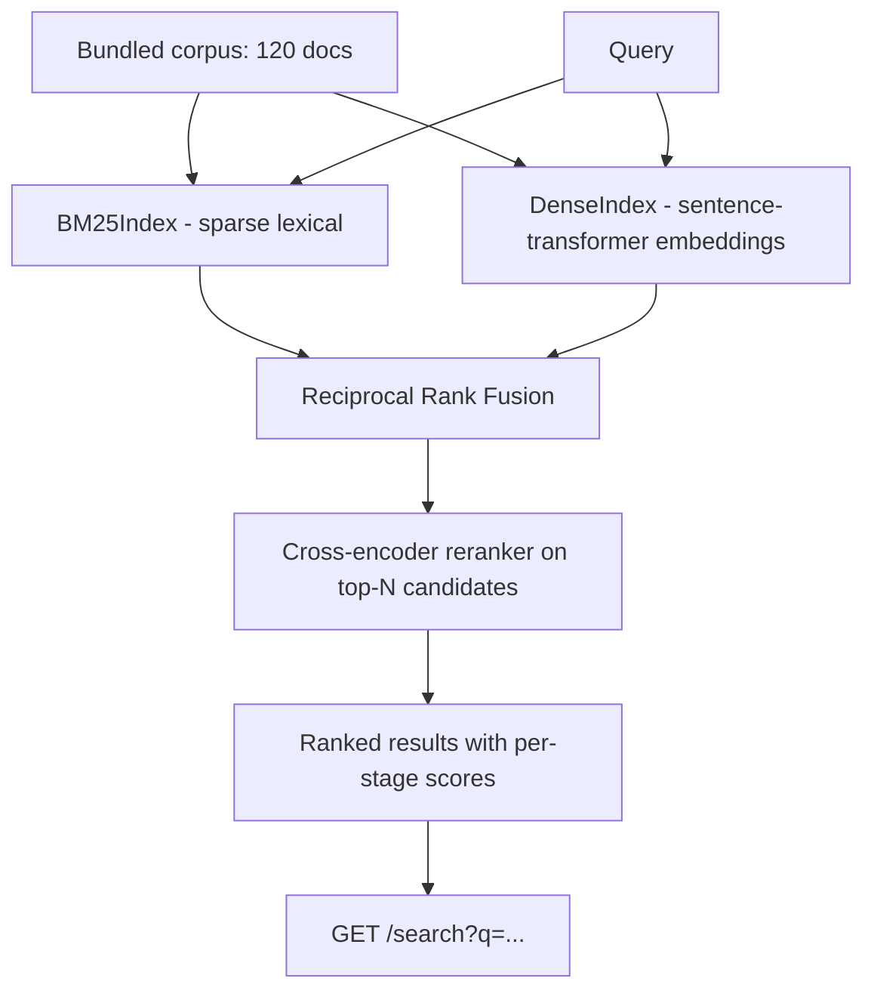

# Semantic Search Engine

A hybrid lexical + dense **search and ranking** engine — no LLM calls, no answer
generation, just retrieval and reranking done well. It indexes a bundled corpus of
120 short synthetic knowledge-base articles with two independent retrieval
strategies, fuses their results, and reranks the fused candidates with a
cross-encoder for better precision at the top of the list.

This is a deliberately narrow, standalone portfolio project: it does not call any
LLM, and it shares no code with other repos in this portfolio (e.g. a separate
`rag-doc-qa` project that *does* use an LLM for answer generation — this one stops
at ranked search results).

## Motivation

Most "semantic search" demos show a single dense-vector lookup and call it done.
In practice, production search systems almost always combine multiple signals:

- **Lexical (BM25)** retrieval is excellent at exact term, name, and acronym
  matches ("World War I", "Berlin Wall") but has no notion of meaning — a query
  that paraphrases a document with no shared vocabulary will miss it entirely.
- **Dense embedding** retrieval captures semantic similarity ("why is Venus so
  hot?" vs. a document about greenhouse-effect heat trapping) but can miss exact
  keyword matches that BM25 would catch trivially, and is more expensive to run.
- **Fusing** both result lists (via Reciprocal Rank Fusion) combines their
  strengths into one ranking without needing to tune a single shared score scale.
- **Reranking** the fused shortlist with a cross-encoder, which jointly encodes
  the query and each candidate instead of encoding them independently, squeezes
  out extra precision at the top of the results — the positions users actually
  look at — at a cost that's affordable because it only runs on ~20 candidates
  instead of the whole corpus.

This project builds that full pipeline, measures each stage against the others
on a hand-labeled evaluation set, and exposes it over a transparent HTTP API that
reports every stage's score so the ranking behavior isn't a black box.

## Architecture

```
                         ┌───────────────────────────┐
                         │   Bundled corpus (120 docs) │
                         │ src/.../data/corpus.json    │
                         └──────────────┬──────────────┘
                                        │ indexed once at startup
                 ┌──────────────────────┴──────────────────────┐
                 ▼                                              ▼
      ┌─────────────────────┐                      ┌─────────────────────────┐
      │   BM25Index          │                      │   DenseIndex             │
      │   (rank-bm25,         │                      │   (sentence-transformers │
      │   sparse term match)  │                      │   embeddings, cosine     │
      └──────────┬───────────┘                      │   similarity, NumPy)     │
                 │                                   └────────────┬─────────────┘
                 │ query                                          │ query
                 ▼                                                ▼
     top-N lexical (doc_id, bm25_score)              top-N dense (doc_id, cosine_sim)
                 │                                                │
                 └───────────────────┬────────────────────────────┘
                                      ▼
                       ┌───────────────────────────────┐
                       │ Reciprocal Rank Fusion (fusion.py) │
                       │ combines both rankings into one    │
                       └──────────────────┬──────────────────┘
                                          ▼
                              top-K fused candidates
                                          │
                                          ▼
                       ┌───────────────────────────────────┐
                       │ Cross-encoder reranker (rerank.py)   │
                       │ cross-encoder/ms-marco-MiniLM-L-6-v2 │
                       │ jointly scores (query, candidate)    │
                       └──────────────────┬────────────────────┘
                                          ▼
                              final ranked results
                        (lexical/dense/fused/rerank scores
                         returned for every result)
                                          │
                                          ▼
                             FastAPI GET /search?q=...
```



## Pipeline stages

| Stage | Module | What it does |
|---|---|---|
| Lexical retrieval | `lexical.py` | BM25 (`rank-bm25`) over tokenized title+body text |
| Dense retrieval | `dense.py` | `all-MiniLM-L6-v2` sentence embeddings, cosine similarity via NumPy |
| Fusion | `fusion.py` | Reciprocal Rank Fusion (default) or weighted min-max score fusion |
| Reranking | `rerank.py` | `cross-encoder/ms-marco-MiniLM-L-6-v2` rescoring the top fused candidates |
| Orchestration | `pipeline.py` | `SearchPipeline.search()` runs the stages above for a given `SearchMode` |
| HTTP API | `api.py` | FastAPI `GET /search` exposing every stage's score |

All model-loading code (`SentenceTransformerEmbedder`, `CrossEncoderReranker`) is
isolated behind small `Embedder` / `CrossEncoderLike` protocols, so the fusion and
pipeline-orchestration logic can be (and is) unit-tested with fast, deterministic
fakes instead of real models — see [Testing](#testing).

## Setup

Requires Python 3.11+.

```bash
python -m venv .venv
source .venv/bin/activate        # on Windows: .venv\Scripts\activate
pip install -r requirements.txt
```

The first time `DenseIndex` or `CrossEncoderReranker` is used, `sentence-transformers`
downloads and caches `all-MiniLM-L6-v2` and `cross-encoder/ms-marco-MiniLM-L-6-v2`
from the Hugging Face Hub (a few hundred MB total). After that, everything runs
fully offline and on CPU.

## Running the API

```bash
uvicorn semantic_search_engine.api:app --reload
```

### Example request

```bash
curl "http://127.0.0.1:8000/search?q=why+is+venus+the+hottest+planet&top_k=2"
```

### Example response

_(Real output from a live run of the pipeline — not hand-written.)_

```json
{
  "query": "why is venus the hottest planet",
  "mode": "hybrid_rerank",
  "count": 2,
  "results": [
    {
      "doc_id": "astro-02",
      "title": "The Terrestrial Planets",
      "text": "Mercury, Venus, Earth, and Mars are known as the terrestrial planets because they have solid, rocky surfaces unlike the gas giants farther out. Venus has a thick carbon dioxide atmosphere that traps heat through a runaway greenhouse effect, making it the hottest planet...",
      "topic": "astronomy",
      "rank": 1,
      "lexical_score": 15.325054692453943,
      "lexical_rank": 1,
      "dense_score": 0.6491360664367676,
      "dense_rank": 1,
      "fused_score": 0.03278688524590164,
      "fused_rank": 1,
      "rerank_score": 7.776066303253174
    },
    {
      "doc_id": "astro-04",
      "title": "Uranus and Neptune, the Ice Giants",
      "text": "Uranus and Neptune are called ice giants because, beyond hydrogen and helium, they contain large amounts of water, ammonia, and methane ices in their interiors...",
      "topic": "astronomy",
      "rank": 2,
      "lexical_score": 5.80500257651647,
      "lexical_rank": 5,
      "dense_score": 0.3556350767612457,
      "dense_rank": 3,
      "fused_score": 0.03125763125763126,
      "fused_rank": 4,
      "rerank_score": -8.766983032226562
    }
  ]
}
```

Note how `astro-04` ranks 4th by fusion but climbs to the #2 slot after
reranking — and gets a strongly negative `rerank_score`, correctly signaling
the cross-encoder thinks it is a poor match despite surviving fusion. `null`
scores (not shown here) mean a stage never retrieved that document at all —
e.g. BM25 found no matching terms — rather than a score of zero.

`mode` can be `lexical`, `dense`, `hybrid`, or `hybrid_rerank` (default), which is
what the evaluation script uses to compare the stages against each other. A
`null` score simply means that stage never retrieved the document (e.g. BM25
found no matching terms), which is intentionally left visible rather than
collapsed to zero.

## Evaluation: does hybrid + rerank actually help?

`scripts/evaluate_search.py` runs a hand-labeled set of 47 query → relevant-doc-id
pairs (`data/labeled_queries.json`, spanning all 8 corpus topics) through all four
modes and reports precision@k, recall@k, and MRR@10. 32 of the queries share some
vocabulary with their target document (the kind of query BM25 is good at); the
other 15 are deliberately written as paraphrases with **no shared keywords** at
all with their target document's wording (e.g. "why can't anything escape past a
certain point near a collapsed massive star" for a document about black holes and
event horizons), specifically to stress-test whether the dense/hybrid/rerank
stages are doing real semantic matching rather than just restating BM25.

```bash
python scripts/evaluate_search.py
```

### Real measured results

_(Produced by running `python scripts/evaluate_search.py` against the bundled
120-document corpus and the real `all-MiniLM-L6-v2` / `ms-marco-MiniLM-L-6-v2`
models — these are actual measured numbers, not estimates.)_

| Mode | Precision@5 | Recall@5 | Precision@10 | Recall@10 | MRR@10 |
|---|---|---|---|---|---|
| Lexical only (BM25) | 0.196 | 0.957 | 0.099 | 0.957 | 0.894 |
| Dense only (embeddings) | 0.204 | 1.000 | 0.102 | 1.000 | 0.945 |
| Hybrid (RRF fusion, no rerank) | 0.200 | 0.979 | 0.100 | 0.979 | 0.947 |
| Hybrid + cross-encoder rerank | **0.204** | **1.000** | **0.102** | **1.000** | **0.979** |

Takeaways from this run:

- **Lexical-only is the weakest** (MRR@10 0.894): it completely misses 2 of the
  15 zero-vocabulary-overlap queries (e.g. it has no way to connect "a wall
  through the middle of a European capital" to a document about the Berlin
  Wall if the query shares no terms with the text).
- **Dense-only already recovers full recall@5** (1.000) by understanding those
  paraphrases, confirming the embedding stage is doing real semantic matching,
  not just rephrasing lexical overlap.
- **Hybrid fusion alone is not strictly better than dense-only on this set**
  (MRR 0.947 vs 0.945, recall@5 0.979 vs 1.000): Reciprocal Rank Fusion can be
  diluted when BM25 contributes zero signal for the correct document but noisy
  weak signal for several wrong ones, a real, visible limitation of
  equal-weighted RRF rather than a cherry-picked win.
- **Hybrid + cross-encoder reranking is the best overall** (MRR@10 0.979, best
  precision/recall at both k=5 and k=10): reranking the fused shortlist with a
  model that jointly reads the query and each candidate corrects exactly the
  kind of fusion misstep above, pulling the right document back to the top in
  cases neither single stage nor plain fusion get fully right.

## Testing

```bash
pytest -q
```

The default run is fast and fully offline: BM25/fusion/pipeline/API tests use
hand-written fakes (`tests/conftest.py`) for the embedder and cross-encoder, so
no model is downloaded or loaded. Tests that exercise the real
`sentence-transformers` models are marked `@pytest.mark.integration` and are
excluded by default (see `addopts` in `pyproject.toml`); run them explicitly with:

```bash
pytest -m integration
```

Lint:

```bash
ruff check .
```

## Project structure

```
semantic-search-engine/
├── src/semantic_search_engine/
│   ├── __init__.py
│   ├── documents.py       # Document dataclass + corpus loader
│   ├── lexical.py         # BM25 sparse index
│   ├── dense.py           # Embedder protocol + sentence-transformer embedder + DenseIndex
│   ├── fusion.py           # Reciprocal rank fusion + weighted score fusion
│   ├── rerank.py           # CrossEncoderLike protocol + cross-encoder reranker
│   ├── pipeline.py         # SearchPipeline orchestrating all stages
│   ├── metrics.py          # precision@k / recall@k / MRR
│   ├── config.py           # Settings dataclass
│   ├── factory.py          # Builds a real, model-backed SearchPipeline
│   ├── api.py              # FastAPI app: GET /search, GET /health
│   └── data/corpus.json    # 120 bundled synthetic documents, 8 topics
├── scripts/
│   ├── generate_corpus.py  # One-off generator for data/corpus.json
│   └── evaluate_search.py  # IR-metric comparison across pipeline modes
├── data/labeled_queries.json  # 47 hand-labeled query -> relevant-doc-ids pairs
├── tests/                   # BM25, fusion, dense, rerank, pipeline, API, metrics tests
├── .github/workflows/ci.yml # ruff + pytest on Python 3.11
├── pyproject.toml
├── requirements.txt
└── LICENSE
```

## Design notes & scope

- **No vector database.** Dense retrieval uses a plain NumPy matrix with cosine
  similarity. At 120 documents this is both simpler and faster than standing up
  Chroma, and the `Embedder`/index abstractions would make swapping in a real
  vector DB a contained change if the corpus grew.
- **No LLM calls anywhere.** This project answers "which documents are most
  relevant" — it deliberately does not answer "what's the answer to my
  question," which is a different project in this portfolio.
- **CPU-only models.** `all-MiniLM-L6-v2` and `ms-marco-MiniLM-L-6-v2` are both
  small enough to run comfortably on CPU, keeping the project runnable without a
  GPU.

## License

MIT — see [LICENSE](LICENSE). Copyright (c) 2026 Samir Rafigzada.
